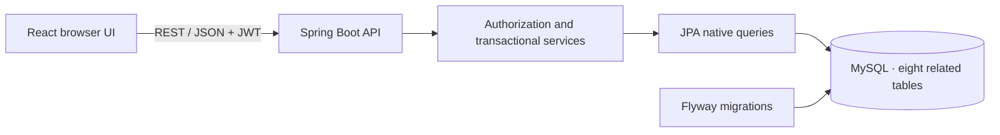
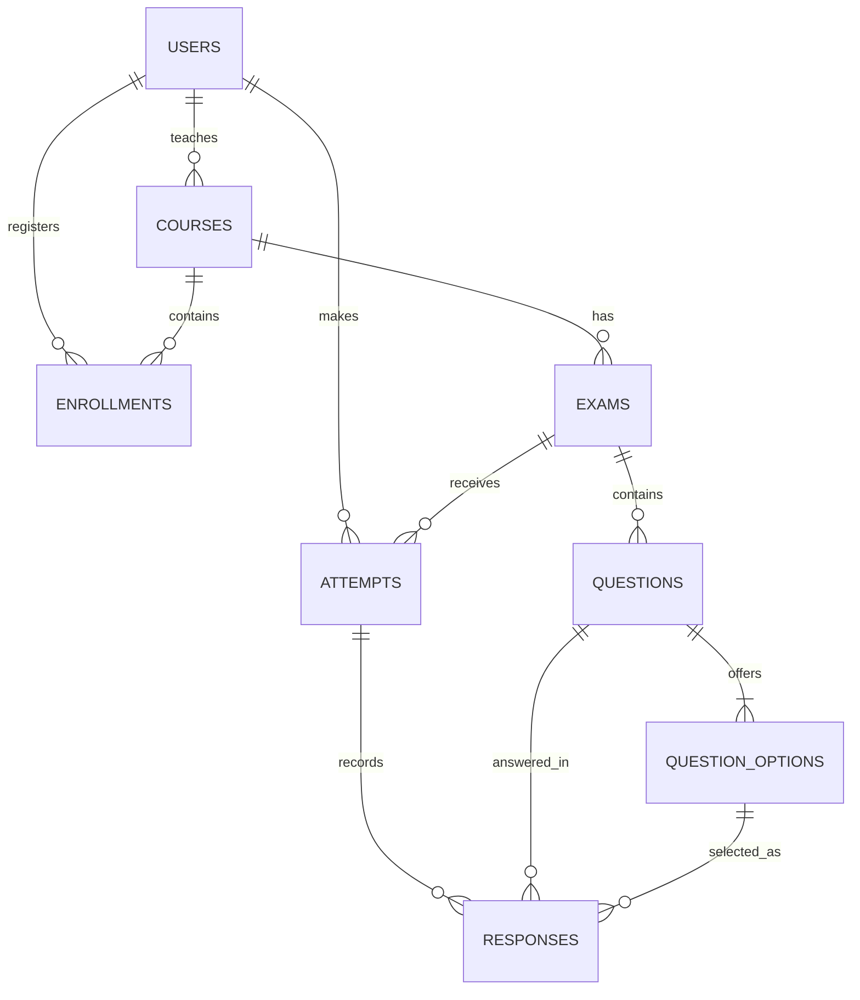

# ExamSpace · Online Examination Management System

[](https://github.com/shiv-eshwar/online-examination-management-system/actions/workflows/ci.yml)

A university examination portal built with **React, TypeScript, Spring Boot, and MySQL**. Administrators manage accounts and enrollments, faculty publish MCQ exams, and enrolled students submit timed attempts with server-calculated scores.

This is a DBMS mini-project with real persistence, relational constraints, role-based access, transactional submission, and SQL reports. See [verification evidence and limitations](docs/IMPLEMENTATION_STATUS.md) for what has actually been tested.

## Features

| Role | What you can do |
|---|---|
| **Administrator** | Create/edit/deactivate users, create/edit courses, assign faculty, manage enrollments, inspect exams, and view institutional results and reports. |
| **Faculty** | View assigned courses and student rosters, author exams and four-option questions, preview/publish/close exams, and view results for assigned courses. |
| **Student** | View enrolled courses and eligible exams, start/resume one timed attempt, save answers, submit, and review released results. |

- JWT authentication and BCrypt password hashes; active-account and role checks on each authenticated request.
- Backend ownership, enrollment, schedule, and exam-state validation.
- Atomic answer saving and final scoring, with a server-enforced deadline.
- MySQL primary/foreign keys, composite constraints, unique enrollments/attempts, and CHECK constraints.
- JOIN/GROUP BY reports for participation, average/highest scores, and pass rates.
- Responsive role-aware screens, confirmation dialogs, search, pagination, and API error feedback.
- Flyway migrations, deterministic local demo data, Swagger UI, and automated tests.

## Technology

| Layer | Stack |
|---|---|
| Frontend | React 18, TypeScript, Vite 8, Tailwind CSS |
| Backend | Java 21, Spring Boot 3, Spring Security, JPA/Hibernate |
| Database | MySQL 8.4 recommended; schema requires MySQL ≥ 8.0.16 |
| Tests | JUnit 5, Spring Boot Test, Vitest, React Testing Library, HTTP acceptance script |



## Quick start

### 1. Install prerequisites and clone

You need **Git**, **Java 21**, **Maven 3.9+**, **Node.js 22.12+**, and **npm**. Use Docker Desktop/Engine for the database steps below, or an existing MySQL server. Verify with `java -version`, `mvn -version`, `node --version`, and `docker info`.

```bash
git clone https://github.com/shiv-eshwar/online-examination-management-system.git
cd online-examination-management-system
cp .env.example .env
```

Commands use a POSIX shell. On Windows, use WSL or Git Bash with Java/Maven/Node available in that environment.

### 2. Configure your local environment

Edit `.env`. These settings must agree:

```dotenv
MYSQL_DATABASE=online_exam_system
MYSQL_USER=exam_app
MYSQL_PASSWORD=choose_a_local_database_password
MYSQL_ROOT_PASSWORD=choose_a_different_root_password

DB_USERNAME=exam_app
DB_PASSWORD=choose_a_local_database_password
DB_URL='jdbc:mysql://localhost:3306/online_exam_system?useSSL=false&allowPublicKeyRetrieval=true&serverTimezone=UTC'

JWT_SECRET=replace_with_your_generated_random_secret
SPRING_PROFILES_ACTIVE=local
SERVER_PORT=8080
FRONTEND_ORIGIN=http://localhost:5173
PASS_PERCENTAGE=40
```

Generate a signing secret with `openssl rand -hex 32` and paste it as `JWT_SECRET`. It must be at least 32 characters. Keep `.env` private; it is ignored by Git. Quote shell-special characters in values because the helper scripts source this file.

`local` enables demo account initialization. It seeds only an empty database and converts the seed password markers into BCrypt hashes. Existing passwords are preserved. `PASS_PERCENTAGE` controls the default threshold for newly created exams.

### 3. Start MySQL

```bash
docker compose up -d mysql
docker compose ps
```

Wait for the database to become **healthy**. Compose starts only MySQL; the backend and frontend run in the next steps. Data is stored in the `examination-data` Docker volume. `docker compose down` preserves it; **`docker compose down -v` deletes the database**.

Already have MySQL? Skip Compose and follow [local MySQL setup](#local-mysql-setup-without-docker).

### 4. Start the backend

From the repository root:

```bash
./scripts/run-backend.sh
```

Flyway creates the application tables. Normal startup uses `ddl-auto=validate`. Wait for Spring Boot to report that it has started. Leave this terminal running.

### 5. Start the frontend

In a second terminal, from the repository root:

```bash
cd frontend
npm ci
npm run dev
```

Open **http://localhost:5173**. If Vite selects another port, free port 5173 or update `FRONTEND_ORIGIN` and restart the backend.

| Service | Address |
|---|---|
| Application | http://localhost:5173 |
| API health | http://localhost:8080/api/v1/health |
| Swagger UI | http://localhost:8080/swagger-ui/index.html |
| OpenAPI JSON | http://localhost:8080/v3/api-docs |

The development frontend proxies `/api` to port 8080. If you change the backend port, update `frontend/vite.config.ts` too. `npm run build` creates frontend static assets; it does not deploy or host the application.

## Demo accounts

**For local assessment only. Do not expose these accounts publicly.**

| Role | Email | Password |
|---|---|---|
| Admin | `admin@demo.edu` | `Admin@123` |
| Faculty | `maya.faculty@demo.edu` | `Faculty@123` |
| Student | `roshan.student@demo.edu` | `Student@123` |
| Student | `aarav.student@demo.edu` | `Student@123` |

The seed includes two courses and a published DBMS quiz. Its availability window is generated on the first seed and lasts 30 days. If it has expired, create a new exam. Public self-registration is disabled.

## Try the complete workflow

1. **Admin:** create a faculty account and a student account under **Users**. Create a course assigned to the faculty account, then enroll the student under **Enrollments**.
2. **Faculty:** sign in and create an exam for that course. Enter the schedule in **UTC**. Open the editor and add questions, each with four options and exactly one correct answer. Question marks must sum to the exam total. Preview and publish.
3. **Student:** sign in during the examination window, open **Exams**, and start. Select answers; autosave and the explicit **Save answers** control persist progress. Submit with confirmation, then view the score/history under **Results**.
4. **Faculty/Admin:** inspect the stored results and **Reports**. The report tables and pass-rate bars use actual database aggregates.

Try duplicate enrollment, another faculty member's exam, or a second attempt to demonstrate rejection. Users are deactivated rather than deleted. An enrollment with attempt history cannot be removed.

## Run tests

Use a **separate assessment database**, not a database containing real academic records. Backend tests require MySQL and demo data; the `local` profile initializes a fresh test database. Tests create temporary records inside rollback transactions. The HTTP acceptance script intentionally retains unique test records and changes the start time of its own deadline-test attempt.

```bash
# Repository root: loads your .env and runs Spring Boot/JUnit tests
./scripts/test-backend.sh

# Frontend unit/component tests and production compilation
cd frontend
npm ci
npm test
npm run build
cd ..

# Running backend + local demo accounts required; Python 3 and MySQL CLI required
set -a
. ./.env
set +a
python3 scripts/acceptance.py
```

The acceptance script covers administration, enrollment, publishing, attempts, scoring, reports, duplicates, forbidden actions, answer secrecy, late submission, and rollback after a partially processed batch. Set `MYSQL_CLI` if `mysql` is not on PATH; `API_BASE_URL` optionally changes the default `http://localhost:8080/api/v1`.

Recorded implementation verification: **4 backend tests, 4 frontend tests, 53 HTTP checks**, successful frontend build, and a successful restart-persistence probe. These are recorded local results, not a claim that every browser workflow has been automated. GitHub Actions independently runs the backend against MySQL and the frontend tests/build on pushes and pull requests.

## Database design

Eight related tables: `users`, `courses`, `enrollments`, `exams`, `questions`, `question_options`, `attempts`, and `responses`.



The unique student/exam pair prevents multiple attempts. Composite foreign keys bind responses to the same exam as their attempt and ensure selected options belong to the exact question. Final submission locks the attempt and commits answers, score, status, and timestamp together; a failure rolls the operation back.

Reports join normalized records and aggregate submitted attempts. Empty groups return zero; pass rate uses each exam's configured threshold. Faculty filtering restricts records before aggregation. See [SQL examples](db/queries.sql), [data dictionary](docs/data_dictionary.md), [full ER source](db/er_diagram.mmd), and [normalization/query rationale](docs/project_report.md).

**Use Flyway for normal setup.** `db/schema.sql` is a standalone destructive reset script; do not run it over a database you want to preserve. Flyway's baseline and standalone schema describe the same eight tables.

## Project layout

```text
backend/                  Spring Boot API, services, persistence, security, tests
  src/main/resources/
    db/migration/         Versioned Flyway schema
frontend/                 React application, component/timer tests, Vite config
db/                       Standalone schema, seed, report SQL, Mermaid ER model
docs/                     Requirements, architecture, API contract, test evidence
scripts/                  Backend run/test helpers and HTTP acceptance checks
.github/workflows/ci.yml  MySQL-backed backend tests and frontend tests/build
.env.example              Configuration template; no real credentials
```

Request bodies and response projections follow the [API contract](docs/api_contract.md). The compact implementation uses JPA native-query projections for most domains and a Spring Data repository for users. Review [implementation details and tradeoffs](docs/IMPLEMENTATION_STATUS.md) before extending it.

## Local MySQL setup without Docker

Start MySQL 8.4 (or ≥ 8.0.16). On macOS, `brew install mysql@8.4` then `brew services start mysql@8.4`. Install Java/Maven separately if needed: `brew install openjdk@21 maven`. A Homebrew Java 21 installation typically uses:

```bash
export JAVA_HOME="/opt/homebrew/opt/openjdk@21/libexec/openjdk.jdk/Contents/Home"
export PATH="$JAVA_HOME/bin:$PATH"
```

Connect as your MySQL administrator and run the following, replacing the password before executing:

```sql
CREATE DATABASE online_exam_system
  CHARACTER SET utf8mb4 COLLATE utf8mb4_0900_ai_ci;
CREATE USER 'exam_app'@'localhost' IDENTIFIED BY 'YOUR_LOCAL_PASSWORD';
GRANT ALL PRIVILEGES ON online_exam_system.* TO 'exam_app'@'localhost';
```

Set `DB_USERNAME=exam_app` and the same password as `DB_PASSWORD` in `.env`. The account needs schema privileges for Flyway. Use a dedicated database, then continue at **Start the backend**.

## Troubleshooting

| Symptom | What to check |
|---|---|
| Java runtime missing / wrong version | Set `JAVA_HOME` to Java 21; check `mvn -version`. |
| Database connection refused | Start MySQL, wait for health, and check host/port in `DB_URL`. |
| Access denied by MySQL | Match `DB_USERNAME`/`DB_PASSWORD` to the database account. Docker initializes passwords only when the data volume is first created. |
| JWT startup error | Set a random `JWT_SECRET` of at least 32 characters. |
| Demo login fails | Enable `local`, verify seed initialization, and check whether the account was deactivated. |
| Existing nonempty schema / Flyway error | Prefer a fresh dedicated database; do not edit an already-applied migration. |
| Browser cannot reach API | Backend must run on 8080, matching Vite's proxy. |
| Exam cannot be started | Check enrollment, published status, UTC schedule, and whether an attempt already exists. |
| Duplicate/state conflict | HTTP 409 is expected for duplicates, published-content edits, and historical deletion restrictions. |
| Test MySQL client missing | Install the MySQL CLI or set `MYSQL_CLI` to its executable path. |

## Security and current limits

This repository is an educational application, not a production hosting deployment. HTTPS, deployment configuration, operational monitoring, and production hardening are outside the verified setup.

- Do not commit `.env`, production credentials, real student records, or database dumps. Local browser screenshots and the supplied Word handout are excluded from the public repository.
- JWTs expire after one hour and are stored in browser session storage. Logout discards the token; there is no refresh-token or revocation store. Deactivation is checked on every request.
- Results are immediately visible after submission. Correct-answer flags are hidden before submission.
- Late submissions are rejected; expired attempts are not automatically finalized.
- User search/pagination is available in SQL. Other tables currently search/page over real records loaded from the API; large-dataset scalability is not verified.
- Full faculty/student browser click-through, mobile visual QA, and Docker Compose execution were not verified in the original local run. Local Chrome checks covered admin login, live reports, and user creation. CI verifies the MySQL service setup when its run succeeds.

## Documentation

- [Implementation status and observed tests](docs/IMPLEMENTATION_STATUS.md)
- [Recorded acceptance results](docs/acceptance-results.txt)
- [Architecture](docs/architecture.md) · [API contract](docs/api_contract.md)
- [Project report and normalization](docs/project_report.md)
- [Test plan and demonstration script](docs/test_plan.md)
- [Teacher rubric traceability](docs/rubric_traceability.md)

When proposing a change, include its purpose and test results, preserve database migrations already applied by other users, and avoid adding secrets or personal records to fixtures.
